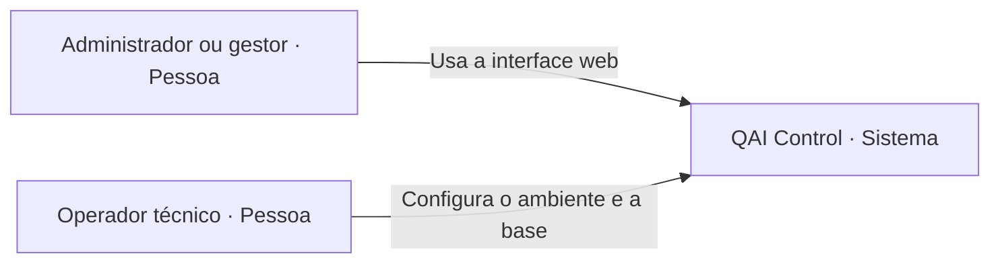
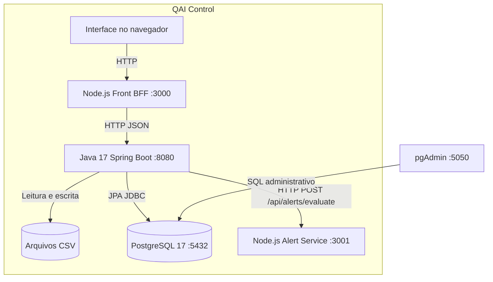
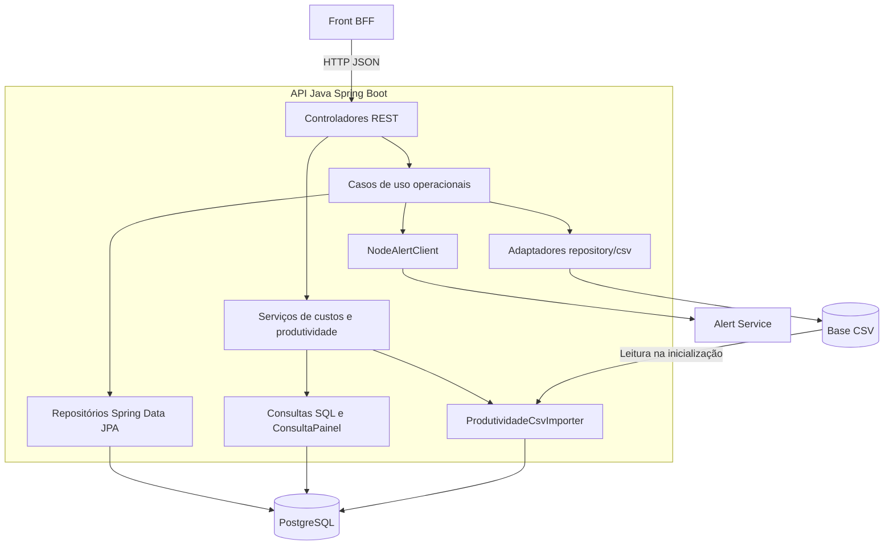
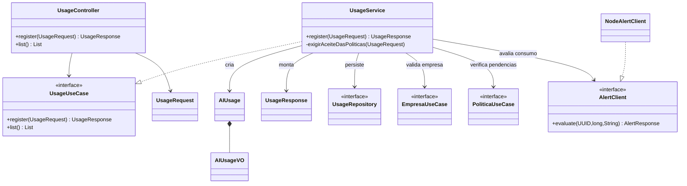

# Modelo C4 do QAI Control

Modelo C4 do QAI Control

Arquitetura da aplicação e rastreabilidade no repositório

O QAI Control reúne cadastros, registros de uso de IA, custos, produtividade, capacitações e políticas de uso. Sua arquitetura combina uma interface web com BFF em Node.js, uma API em Java e Spring Boot, um serviço de alertas e persistência híbrida em arquivos CSV e PostgreSQL.

Este documento apresenta a arquitetura em quatro níveis de abstração, do contexto do sistema às classes do fluxo de registro de consumo. Cada visão amplia um elemento da anterior e relaciona os elementos arquiteturais aos arquivos que os implementam.

| Referência | Versão analisada |
| --- | --- |
| Repositório | ProjetoIntegrado4/QAIcontrol |
| Branch | main |
| Commit | 96498a5c34d9289b71cc49d4bf2c873d51329aab |
| Data da análise | 23 de outubro de 2026 |
| Aplicação principal | Projeto_IV/Projeto_IV_QSOFT_Home_Paginas_Evoluido/ |

### Como percorrer o documento

| Nível | Pergunta respondida | Seção |
| --- | --- | --- |
| 1 Contexto | Quem utiliza o sistema e para quê? | Página 2 |
| 2 Containers | Quais aplicações e armazenamentos o compõem? | Páginas 3 e 4 |
| 3 Componentes | Como a API e os serviços organizam suas responsabilidades? | Páginas 5 e 6 |
| 4 Código | Quais classes participam do registro de consumo? | Páginas 7 e 8 |

As pastas de estatística, aprendizado de máquina, análise preditiva e materiais acadêmicos compõem o trabalho do projeto. A aplicação executável descrita aqui é a definida pelo Docker Compose da pasta principal. Estudos e propostas do README geral não são tratados como serviços de produção.

---

## Nível 1 Contexto do sistema

O sistema apoia o acompanhamento do uso de IA nas organizações. O administrador ou gestor acessa a interface para manter cadastros, registrar consumos e consultar indicadores, custos, capacitações e governança.

Figura 1. Contexto do QAI Control. Os papéis descrevem atividades; o login implementado é o administrador temporário.

### Papéis e interações

**Administrador ou gestor:** cadastra empresas, administradores e funcionários; registra consumo; publica políticas e novas versões; consulta custos e painéis. A publicação de políticas exige ROLE_ADMIN. As demais operações seguem as regras de autenticação configuradas na API.

**Colaborador:** é representado nos registros de capacitação e aceite de políticas. Nas telas atuais ele é selecionado pelo operador autenticado; não há login próprio de funcionário conectado aos cadastros. Por isso, não aparece como usuário autenticado independente no diagrama.

### Fronteira do sistema

A interface, a API, o serviço de alertas e os dados pertencem à solução. Não há chamada implementada a provedores de IA no fluxo de consumo: o nome do modelo e a quantidade de tokens são dados recebidos pela API. O alerta classifica esse registro; ele não executa o modelo informado.

---

## Nível 2 Containers

No C4, container representa uma aplicação executável ou um armazenamento de dados. O Docker Compose também configura containers de infraestrutura; esses dois usos do termo não são equivalentes. O diagrama inclui o código executado no navegador e o armazenamento em arquivos.

Figura 2. Containers e dependências. As setas indicam chamadas ou acesso a dados; as respostas percorrem o caminho inverso. O pgAdmin é ferramenta de apoio.

| Container | Responsabilidade e interfaces |
| --- | --- |
| Interface web | Páginas em frontend/public e módulos JavaScript de produtividade. Acessa /api/* e /bff/dashboard no BFF. |
| Front e BFF | Serve a interface; encaminha cookies e CSRF; agrega GET /api/empresa e GET /api/usages para o dashboard. |
| API de negócio | Spring Boot 3.5.5, Java 17, Spring Security, JPA e JDBC. Expõe endpoints REST, OpenAPI e health. |

---

## Nível 2 Persistência e execução

| Elemento | Como funciona na versão analisada |
| --- | --- |
| Base CSV | companies.csv, employees.csv, departments.csv e admins.csv sustentam os cadastros. QSOFT_DADOS_DIR define a pasta; no Docker ela é montada em /app/dados com escrita habilitada. |
| Identificadores | A API usa UUIDs derivados de tipo e código CSV por CodigoCsv. Os códigos de negócio, como C01 e C01-E0001, continuam nos arquivos e nos filtros analíticos. |
| PostgreSQL operacional | AIUsage, PoliticaUso, AceitePolitica e Certificacao são persistidos com JPA. Empresas e funcionários externos ao banco são referenciados por IDs; a empresa de PoliticaUso é @Transient. |
| PostgreSQL analítico | O importador carrega os CSVs na inicialização quando a tabela não existe ou está vazia. Consultas de custos e produtividade usam as tabelas e colunas mapeadas em produtividade.yml. |
| Alertas | Não têm persistência em banco. O serviço Node mantém um array de até 50 registros e o reinício apaga esse histórico. GET /api/alerts expõe a lista do próprio serviço. |
| pgAdmin | Interface administrativa do PostgreSQL, separada das funcionalidades de negócio. O Compose publica 5050 no host, mapeada para a porta 80 do serviço. |

### Fluxo de dados e atualização

Os cadastros leem e escrevem diretamente nos CSVs por EmpresaCsvRepository, FuncionarioCsvRepository e AdminCsvRepository. Os adaptadores verificam a versão dos arquivos e reconstroem os dados em memória quando detectam alteração.

Custos e produtividade consultam o PostgreSQL, não esses arquivos diretamente. O importador de inicialização retorna sem alterar uma tabela que já contenha linhas. Assim, modificar um CSV ou cadastrar uma nova empresa no site **não atualiza automaticamente uma tabela analítica já preenchida**. Recarregar a página repete a consulta ao banco. Essa é uma consequência do fluxo implementado.

### Topologia de execução

O Compose cria backend, frontend, alert-service, postgres e pgadmin na rede app_net. Publica as portas 3000, 8080, 3001, 5432 e 5050 no host. postgres_data e pgadmin_data são volumes nomeados; a base CSV e os arquivos públicos do frontend usam bind mounts. O Docker Compose orquestra a execução, sem constituir um componente de negócio.

A análise descreve a configuração do repositório. Ela não pressupõe ambiente de produção implantado nem execução dos serviços durante esta documentação.

---

## Nível 3 Componentes da API

Ampliação do container Java. Os componentes abaixo agrupam classes por responsabilidade, mantendo os nomes reais dos pacotes como referência. São blocos internos de um mesmo processo Spring Boot; não representam microsserviços separados.

Figura 3. Grupos de componentes da API. SecurityConfig atua sobre os endpoints e ApiExceptionHandler traduz exceções em respostas HTTP. O importador acessa CSV e PostgreSQL via JDBC.

### Direção das dependências

Os controladores recebem DTOs e dependem de interfaces de casos de uso. Os serviços aplicam as regras e chamam contratos de repositório ou integração. A injeção de dependências do Spring fornece as implementações concretas, como UsageService, EmpresaCsvRepository e NodeAlertClient.

DTOs delimitam os dados de entrada e saída. Entidades e objetos de valor representam o domínio e validam seus dados. Componentes de configuração fornecem parâmetros de segurança, custos, importação e produtividade.

---

## Nível 3 Responsabilidades dos componentes

| Componente | Responsabilidade e colaboração |
| --- | --- |
| Cadastros | EmpresaService, AdminService e FuncionarioService usam os contratos de repositório. Os adaptadores CSV atribuem códigos e gravam os arquivos; TabelaCsv concentra leitura, cache e escrita. |
| Consumo | UsageService valida a empresa; quando funcionarioId é informado, verifica políticas pendentes; grava AIUsage e solicita o alerta. UsageController expõe POST e GET /api/usages. |
| Governança | PoliticaService publica versões, lista pendências e registra aceites. PoliticaUso preserva código e histórico de versões; nova versão exige novo aceite. |
| Capacitação | CertificacaoService registra cursos ou certificações e consulta histórico e resumo. PontuacaoAiLiteracy aplica os pesos configurados para cada tipo. |
| Custos | CustosService valida filtros, obtém agregações de CustosConsultas e aplica RegraCusto. Usa preços de ai_models e tokens de ai_usage_logs; responde com memória da regra e usos sem preço. |
| Produtividade | ProdutividadeService executa implementações de SecaoPainel em paralelo. CatalogoBanco e Disponibilidade conferem tabelas e colunas; ConsultaPainel executa SQL mapeado por EsquemaBase. |
| Importação | ProdutividadeCsvImporter implementa ApplicationRunner. Lê CSVs na inicialização, deduz tipos e carrega tabelas ausentes ou vazias; utiliza transação por carga. |
| Segurança e erros | SecurityConfig configura sessão HTTP, BCrypt, CSRF e autorização. AuthController e AuthService tratam login e sessão; ApiExceptionHandler converte falhas de validação e domínio. |

### Componentes dos serviços Node

**Front/BFF:** o middleware consulta /api/auth/me antes de servir páginas protegidas; /api encaminha requisições e respostas à API; /bff/dashboard consulta empresas e usos em paralelo, conta os registros e soma tokens. A aplicação também serve frontend/public.

**Alert Service:** um módulo Express contém validação, avaliação por limiares e lista em memória. Tokens abaixo de 5.000 geram INFO; a partir de 5.000, WARNING; a partir de 10.000, CRITICAL. O serviço retorna level e message de forma síncrona. Não há fila ou envio de e-mail nesse fluxo.

---

## Nível 4 Código do registro de consumo

Ampliação do componente de consumo. O diagrama mostra classes e interfaces reais, com dependências simplificadas. Pacote raiz Java: br.edu.exemplo.ia. As setas tracejadas indicam realização de uma interface; as contínuas indicam uso ou dependência.

Figura 4. Classes do fluxo de consumo. UsageRepository persiste em PostgreSQL; NodeAlertClient envia HTTP ao serviço Node. As implementações de EmpresaUseCase e PoliticaUseCase são EmpresaService e PoliticaService.

UsageRequest exige empresaId, tokens positivos e model não vazio. O campo funcionarioId é opcional. O controller usa @Valid; o serviço valida a existência da empresa e o domínio valida os dados de uso. AIUsage armazena empresaId, dados do uso e occurredAt, sem persistir funcionarioId.

---

## Nível 4 Comportamento e limites do fluxo

### Registro de consumo passo a passo

| Etapa | Comportamento |
| --- | --- |
| 1 Entrada | O navegador envia POST /api/usages ao BFF com empresaId, tokens, model e, opcionalmente, funcionarioId. O BFF encaminha JSON, cookie de sessão e token CSRF. |
| 2 Autorização e validação | Spring Security verifica sessão e CSRF. UsageController valida o DTO e chama UsageUseCase.register. |
| 3 Empresa e governança | UsageService verifica EmpresaUseCase.exists. Se houver funcionarioId, PoliticaUseCase.listarPendentes valida o vínculo e procura políticas obrigatórias sem aceite. Pendências geram AceitePendenteException e resposta 409 antes da gravação. |
| 4 Persistência | AIUsage e AIUsageVO representam o consumo; UsageRepository.save grava o uso no PostgreSQL. O cadastro da empresa é consultado na base CSV, por seu UUID derivado. |
| 5 Alerta | NodeAlertClient chama POST /api/alerts/evaluate no Node. O serviço calcula o nível com base nos tokens e mantém o registro em memória. |
| 6 Resposta | UsageService monta UsageResponse com os dados persistidos e o alerta; a resposta volta pelo BFF à interface. GET /api/usages retorna UsageSummaryResponse, sem nível de alerta. |

### Implicações da implementação

**Consistência entre gravação e alerta:** save ocorre antes da chamada HTTP, sem uma transação distribuída envolvendo o Node. Uma falha na avaliação pode ocorrer depois de o uso já estar persistido. O cliente não implementa fila, retry ou circuit breaker. A alternativa UNKNOWN cobre resposta sem corpo, não erros de transporte.

**Identidade e governança:** o bloqueio de uso depende de funcionarioId ter sido informado. A escolha do colaborador na tela ainda não está vinculada à identidade da sessão. A autenticação atual usa um usuário administrador em memória.

**Análises e inovação:** custos e AI Literacy têm parâmetros preliminares no código. O AI Dependency Risk Score e suas visualizações são propostas do README geral e de materiais analíticos; não aparecem como serviço conectado no Compose ou como fluxo integrado nessa API.
